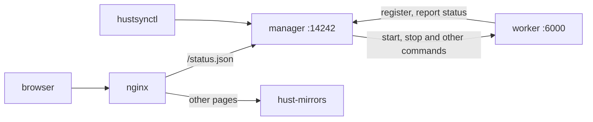

# Deployment



## systemd

`deploy/systemd/` has unit files for the manager and the worker: the binary goes in `/usr/bin/hustsync`, configs in `/etc/hustsync/`, and both run as the `hustsync` user.

```bash
useradd --system hustsync
install -m 755 target/release/hustsync target/release/hustsynctl /usr/bin/
install -m 644 deploy/systemd/hustsync-*.service /etc/systemd/system/
systemctl enable --now hustsync-manager hustsync-worker
```

`systemctl reload hustsync-worker` rereads the mirror list, as `hustsynctl reload -w <worker>` does.

## docker compose

`deploy/compose/` brings up the whole set: manager, worker, the mirror site front end and nginx.

```bash
cd deploy/compose
docker compose up -d --build
```

Open `http://<host>:8080/syncing-status/` to see the mirrors in `worker.toml`. After editing `worker.toml`, run `docker compose restart worker`. Mirror data lives in the `data` volume and nginx serves it directly; the manager database lives in the `db` volume. Change the port with `HTTP_PORT=18080 docker compose up -d`.

`web` is built from source fetched from GitHub. If git cannot reach it, download the source archive, unpack it locally and point `build.context` at it in an override file.

## Front end

The mirror site front end, [hust-mirrors](https://github.com/hust-open-atom-club/hust-mirrors), reads status from `/status.json`, which nginx forwards to the manager's `/jobs`:

```nginx
location = /status.json {
    proxy_pass http://127.0.0.1:14242/jobs;
}
```

A mirror that has never synced reports `last_update` as `0001-01-01`, shown as N/A, as with tunasync.

## Keeping tunasync scripts

`hustsynctl` takes the same arguments and prints the same fields as `tunasynctl`; arguments can go before or after the subcommand. For scripts that call `tunasynctl`, a link is enough:

```bash
ln -s /usr/bin/hustsynctl /usr/bin/tunasynctl
```

The compose image already has this link.

## Migrating from tunasync

| Item | What to do |
|:--:|:--:|
| Manager | Switch to the hustsync manager and set `db_type` to `redb`; bolt data is not migrated, and status fills in at the workers' next reports |
| Worker config | Use it as it is; unsupported keys are rejected, so remove them |
| Sync scripts | `TUNASYNC_*` variables are still provided |

During migration, run hustsync alongside tunasync first: hustsync syncs into another directory without serving it, and you compare both `/jobs` for a while before switching.
