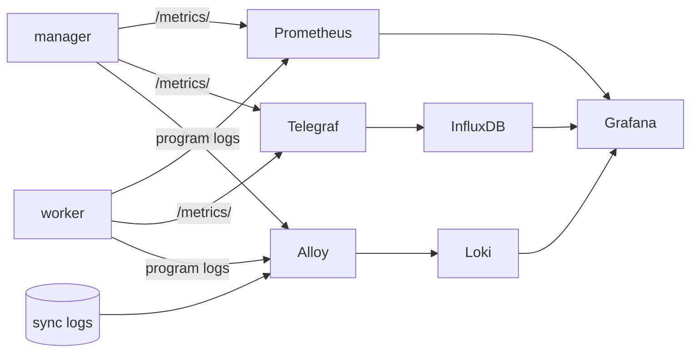

# Monitoring stack

`deploy/` has the configs for monitoring, and compose's `monitoring` profile brings them all up with one command:

```bash
cd deploy/compose
docker compose --profile monitoring up -d
```

Grafana is at `http://<host>:3000`, user `admin`, with the password from `GRAFANA_PASSWORD`, `admin` by default. The boards are in the hustsync folder and show data straight away.



## Components

| Component | Config | Role |
|:--:|:--:|:--:|
| Prometheus 3.15 | `deploy/prometheus/prometheus.yml` | Scrapes each group on its own interval: mirror state every 15 s, sync counts every 30 s, workers and processes every minute |
| Alert rules | `deploy/prometheus/rules.yml` | See below |
| Alloy 1.20 | `deploy/alloy/config.alloy` | Takes program logs pushed by serlog on port 3100; tails the sync logs under each mirror's `log_dir`, taking the mirror name from the file name; takes OTLP metrics on port 4318 and forwards them to Prometheus |
| Loki 3.7 | The image's own config | Stores logs |
| Telegraf 1.40 | `deploy/telegraf/telegraf.conf` | Scrapes the groups, takes pushes on port 8186 and writes to InfluxDB |
| Grafana 13.2 | `deploy/grafana/` | Data sources and boards load with the container |
| InfluxDB 3 Core | compose | Reachable only inside the compose network; one query reads at most 432 Parquet files, about five days of data, so longer ranges need `--query-file-limit` |

The manager's and the worker's `[log]` already push to Alloy with `on_fail = "ignore"`: without the `monitoring` profile, logs still go to the console and failed pushes are dropped quietly.

## Alert rules

| Rule | Condition |
|:--:|:--:|
| `HustsyncManagerDown` | Scraping the manager fails for 5 minutes |
| `HustsyncWorkerDown` | A worker does not answer for 10 minutes |
| `HustsyncMirrorFailing` | 3 failed rounds in a row |
| `HustsyncMirrorStale` | No success for two days, paused and disabled mirrors excepted, for 30 minutes |
| `HustsyncMirrorOverdue` | Not started an hour after its scheduled time, for 15 minutes |
| `HustsyncMirrorStuck` | Syncing for more than a day |

The rules have unit tests:

```bash
promtool test rules deploy/prometheus/rules.test.yml
```

To use Alertmanager, add an `alerting` section to `prometheus.yml`. For hustsync's own alert mails, see [alert.md](alert.md).

## Boards

The boards load with Grafana into the hustsync folder, refresh every 5 minutes by default and link to each other at the top.

| Board | File | Use |
|:--:|:--:|:--:|
| Overview | `hustsync.json` | The first screen shows everything; details follow below |

### Overview, first screen

Fits one 1920×1080 screen:

| Panel | Form |
|:--:|:--:|
| Title and clock | Ticks every second in the page |
| Mirrors, 24 h success rate, total size, failed, syncing, workers online | Numbers with recent trends, two rows of three |
| Status breakdown | Rounded ring with the mirror total in the middle |
| Synced in the last 24 h, concurrency in use | Two progress rings |
| Coming up | Countdown for the next 10 mirrors, ticking every second in the page; overdue ones turn red |

### Overview, further down

| Section | Panel | Form |
|:--:|:--:|:--:|
| Sync activity | Syncs | One bar per 10 minutes, green for success and red for failure |
| | Size | Treemap grouped by worker; area is size |
| | Daily syncs, daily failures | Calendar heatmaps of the last 90 days |
| Mirrors | Needs attention | Table of mirrors not in success, with failures in a row and time since the last success |
| | All mirrors | Table of status, time since the last success, last success and next sync, last duration, failures in a row, size, worker, role and upstream; sortable and filterable |
| | Longest without success, most failures in 7 days | Bars |
| Status | What each mirror is doing | Timeline: grey idle, green syncing, red a failed round, yellow paused |
| Duration | Duration spread, slowest 10 | Heatmap and bars; clicking a mirror opens the mirrors board |
| | Longest 8, hourly syncs over 24 h | Lines and bars |
| Topology | Manager, workers and mirrors | Radial tree; mirrors coloured by status, offline workers red |
| Workers | Online, running, queued | State history and lines |
| Processes | CPU, memory, threads, file descriptors | Lines |
| Alerts | Firing alerts, scrapes | Table and timeline |
| Logs | Program log volume, program logs, alert events, sync logs | Bars and logs |

Program logs are pushed by hustsync through the loki sink in `[log]`; sync logs are the files hustsync writes in `log_dir`, read by Alloy.

### Plugins

| Plugin | Used for |
|:--:|:--:|
| `marcusolsson-treemap-panel` | Size |
| `volkovlabs-echarts-panel` | Status breakdown, progress rings, topology |
| `marcusolsson-dynamictext-panel` | Title clock, coming up |
| `tim012432-calendarheatmap-panel` | Daily syncs, daily failures |

Compose installs them through `GF_PLUGINS_PREINSTALL_SYNC`; every other panel is built in. When importing into another Grafana, install the plugins first, then pick your own Prometheus, Loki or InfluxDB at the top.

## Without compose

| Component | What to do |
|:--:|:--:|
| Prometheus | Change the `targets` in `prometheus.yml` |
| Grafana | Import the JSON in `deploy/grafana/dashboards/` and install the plugins above |
| Alloy | Replace `/var/log/hustsync` in `config.alloy` with the worker's `log_dir` |
| Telegraf | Change `urls` and the output |
