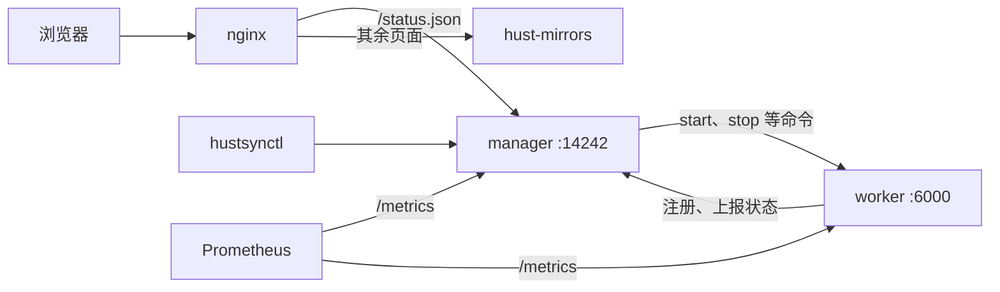

# 部署



## systemd

`deploy/systemd/` 下有 manager 与 worker 的单元文件，二进制放 `/usr/bin/hustsync`，配置放 `/etc/hustsync/`，以 `hustsync` 用户运行。

```bash
useradd --system hustsync
install -m 755 target/release/hustsync target/release/hustsynctl /usr/bin/
install -m 644 deploy/systemd/hustsync-*.service /etc/systemd/system/
systemctl enable --now hustsync-manager hustsync-worker
```

`systemctl reload hustsync-worker` 重读镜像列表，等同 `hustsynctl reload -w <worker>`。用 cgroup 时在 worker 单元加 `Delegate=yes`，见 [cgroup.md](cgroup.md)。

## docker compose

`deploy/compose/` 起一整套：manager、worker、镜像站前端与 nginx。

```bash
cd deploy/compose
docker compose up -d --build
```

浏览器打开 `http://<主机>:8080/syncing-status/` 即可看到 `worker.toml` 里的镜像。改 `worker.toml` 后 `docker compose restart worker`。镜像数据在卷 `data`，manager 数据库在卷 `db`。端口用 `HTTP_PORT=18080 docker compose up -d` 修改。

worker 要跑容器镜像时，把宿主的 `/var/run/docker.sock` 挂进 worker，并使镜像目录在宿主与 worker 内路径相同，容器才能挂到正确的目录。

## 前端

镜像站前端 [hust-mirrors](https://github.com/hust-open-atom-club/hust-mirrors) 从 `/status.json` 读取状态，内容即 manager 的 `/jobs`，交给 nginx 转发：

```nginx
location = /status.json {
    proxy_pass http://127.0.0.1:14242/jobs;
}
```

从未同步成功的镜像，`last_update` 为 `0001-01-01`，前端显示为 N/A，与 tunasync 一致。

## 监控

manager 与 worker 都提供 `/metrics` 与按组拆分的 `/metrics/<组>`，也可推给 Telegraf、InfluxDB 或 Alloy，指标、配置与收端见 [metrics.md](metrics.md)。

```yaml
scrape_configs:
  - job_name: hustsync
    static_configs:
      - targets: ["manager:14242", "worker:6000"]
```

告警示例：

```yaml
- alert: MirrorStale
  expr: time() - hustsync_mirror_last_success_timestamp_seconds > 2 * 86400
- alert: WorkerDown
  expr: hustsync_worker_up == 0
  for: 10m
```

## 沿用 tunasync 的运维脚本

`hustsynctl` 的参数和输出字段与 `tunasynctl` 相同，参数既可放在子命令前，也可放在之后。脚本里写死 `tunasynctl` 的，建一个链接即可：

```bash
ln -s /usr/bin/hustsynctl /usr/bin/tunasynctl
```

compose 镜像里已经带了这个链接。

## 从 tunasync 迁移

| 项 | 做法 |
|:--:|:--:|
| manager | 换成 hustsync manager，`db_type` 改为 `redb`；bolt 数据不迁移，worker 下次上报后状态自动补齐 |
| worker 配置 | 原样使用；`zfs`、`btrfs_snapshot` 等不支持的字段会报错，删掉即可 |
| 同步脚本 | `TUNASYNC_*` 环境变量照常提供 |
| 容器 | 名字前缀由 `tunasync-job-` 变为 `hustsync-job-`，按名字清理容器的脚本要改 |
| 端口 | worker 的 `listen_port` 现在同时提供 `/metrics` |

迁移时先让 hustsync 与 tunasync 并行跑：hustsync 同步到另一个目录、不对外服务，比对两边 `/jobs` 一段时间再切换。
