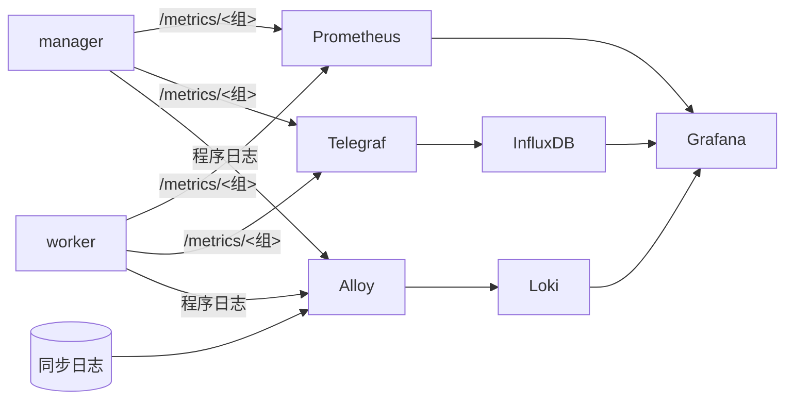

# 监控栈

`deploy/` 下备好了从指标、日志到看板与告警的整套配置，compose 的 `monitoring` profile 一条命令起齐：

```bash
cd deploy/compose
docker compose --profile monitoring up -d
```

Grafana 在 `http://<主机>:3000`，账号 `admin`，密码取 `GRAFANA_PASSWORD`，默认 `admin`。看板在 hustsync 目录下，打开即有数据。



## 组件

| 组件 | 配置 | 作用 |
|:--:|:--:|:--:|
| Prometheus 3.15 | `deploy/prometheus/prometheus.yml` | 各组按各自的间隔抓取：镜像状态 15 秒，同步计数 30 秒，worker 与进程 1 分钟 |
| 告警规则 | `deploy/prometheus/rules.yml` | 见下表 |
| Telegraf 1.40 | `deploy/telegraf/telegraf.conf` | 拉取各组，也在 8186 端口收推送，写进 InfluxDB |
| InfluxDB 3 Core | compose | 只在 compose 网络内可达 |
| Alloy 1.20 | `deploy/alloy/config.alloy` | 3100 端口收 serlog 推来的程序日志；读各镜像 `log_dir` 下的同步日志，从文件名取镜像名；4318 端口收 OTLP 指标转给 Prometheus |
| Loki 3.7 | 镜像自带配置 | 存日志 |
| Grafana 13.2 | `deploy/grafana/` | 数据源与看板随容器加载 |

manager 与 worker 的 `[log]` 已配好推给 Alloy，`on_fail = "ignore"`，不起 `monitoring` 时日志照常写控制台，推不出去的静默丢弃。

## 告警规则

| 规则 | 条件 |
|:--:|:--:|
| `HustsyncManagerDown` | manager 抓取失败 5 分钟 |
| `HustsyncWorkerDown` | worker 不响应 10 分钟 |
| `HustsyncMirrorFailing` | 连续失败 3 轮 |
| `HustsyncMirrorStale` | 两天未同步成功，暂停与禁用的除外，持续 30 分钟 |
| `HustsyncMirrorOverdue` | 过了排期一小时仍未开始，持续 15 分钟 |
| `HustsyncMirrorStuck` | 同步持续超过一天 |

规则带单元测试：

```bash
promtool test rules deploy/prometheus/rules.test.yml
```

接 Alertmanager 时在 `prometheus.yml` 加 `alerting` 一节。程序自己发的告警邮件见 [alert.md](alert.md)。

## 看板

四块看板随 Grafana 加载，在 hustsync 目录下，默认 5 分钟刷新，顶部互相链接。

| 看板 | 文件 | 用途 |
|:--:|:--:|:--:|
| 总览 | `hustsync.json` | 第一屏看全局，往下是各个分项的细节 |
| 镜像 | `hustsync-mirrors.json` | 只看镜像：需要关注、一览、状态、耗时、同步日志 |
| 运维 | `hustsync-ops.json` | 只看运维：告警、worker、进程、程序日志、`/jobs` 原文 |
| InfluxDB | `hustsync-influx.json` | 只有 Telegraf 与 InfluxDB 时用 |

### 总览第一屏

1920×1080 一屏装下：

| 面板 | 形式 |
|:--:|:--:|
| 标题与时钟 | 页内每秒走 |
| 镜像、24 小时成功率、总体积、失败、同步中、worker 在线 | 数字加近期走势，两行三列 |
| 状态分布 | 圆角环形，中间写镜像总数 |
| 24 小时内同步成功、并发占用 | 两个进度环 |
| 即将同步 | 最近 10 个镜像的倒计时，页内每秒倒数，已过排期的变红 |

### 总览往下

| 节 | 面板 | 形式 |
|:--:|:--:|:--:|
| 同步活动 | 同步次数 | 每 10 分钟一根柱，成功绿失败红 |
| | 体积 | TreeMap，按 worker 分组，面积即体积 |
| | 每日同步、每日失败 | 近 90 天的日历热力图 |
| 镜像 | 需要关注 | 表格：不是成功的镜像，带连续失败与上次成功距今 |
| | 镜像一览 | 表格：状态、上次成功距今、上次成功与下次同步的时间、上次耗时、连续失败、体积、worker、角色、上游，可排序筛选 |
| | 最久未成功、7 天失败最多 | 条形 |
| 状态 | 各镜像在做什么 | 时间轴：灰色空闲，绿色同步，红色是一轮失败，黄色暂停 |
| 耗时 | 耗时分布、最慢的 10 个 | 热力图、条形，点镜像名跳到镜像看板 |
| | 耗时最长的 8 个、近 24 小时每小时同步 | 曲线、柱状 |
| 拓扑 | manager、worker 与镜像 | 放射树，镜像按状态着色，worker 离线为红 |
| worker | 在线、运行中、排队 | 状态历史、曲线 |
| 进程 | CPU、内存、线程、文件句柄 | 曲线 |
| 告警 | 正在触发的告警、抓取 | 表格、时间轴 |
| 日志 | 程序日志量、程序日志、告警事件、同步日志 | 柱状、日志 |

程序日志由 hustsync 经 `[log]` 里的 loki 输出端直接推送；同步日志是 hustsync 写在 `log_dir` 下的文件，由 Alloy 读取。

### InfluxDB

数据来自 Telegraf 写进的 InfluxDB，用 InfluxQL 查询：总览数字、镜像一览、状态、状态分布、同步次数、最大的镜像与并发。

### 插件

| 插件 | 用在 |
|:--:|:--:|
| `marcusolsson-treemap-panel` | 体积 |
| `volkovlabs-echarts-panel` | 状态分布、进度环、拓扑 |
| `marcusolsson-dynamictext-panel` | 标题时钟、即将同步 |
| `tim012432-calendarheatmap-panel` | 每日同步、每日失败 |
| `yesoreyeram-infinity-datasource` | 运维看板的 `/jobs` 原文 |

compose 已通过 `GF_PLUGINS_PREINSTALL_SYNC` 装好；其余全是内置面板。导入别的 Grafana 时先装插件，再在顶部选上自己的 Prometheus、Loki 或 InfluxDB。

## 不用 compose 时

| 组件 | 做法 |
|:--:|:--:|
| Prometheus | 照 `prometheus.yml` 改 `targets` |
| Grafana | 导入 `deploy/grafana/dashboards/` 下的 JSON，装树图插件 |
| Alloy | 把 `config.alloy` 里的 `/var/log/hustsync` 换成 worker 的 `log_dir` |
| Telegraf | 改 `urls` 与输出 |
